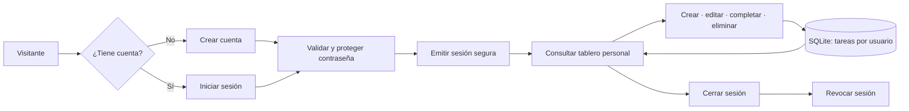

# Pulso

Pulso es un gestor de tareas web en español: organiza pendientes por categoría, fecha límite y estado, y mantiene cada cuenta separada. La interfaz se sirve desde Node.js y se adapta a pantallas móviles y de escritorio.

## Requisitos

- Node.js 22.13 o superior (incluye el módulo SQLite `node:sqlite`).
- No se requieren paquetes npm ni una base de datos externa.

## Puesta en marcha

```powershell
npm start
```

Abre <http://localhost:3000>. Para elegir otro puerto, establece la variable `PORT`. La base de datos se crea automáticamente en `data\pulso.db`; para cambiar su ubicación, define `PULSO_DB_PATH` (o edita el valor predeterminado en `server.js`). En despliegues con HTTPS, define `NODE_ENV=production` para habilitar la marca `Secure` en la cookie de sesión.

## Funcionalidades

- Registro, inicio y cierre de sesión.
- Contraseñas derivadas con `scrypt` y sal aleatoria; nunca se guardan en texto plano.
- Crear, editar, completar y eliminar tareas.
- Título, descripción opcional, fecha límite y categorías personalizadas.
- Filtros por vista, categoría, estado y búsqueda.
- Resumen de progreso y próximas fechas.
- Persistencia local en SQLite y separación de datos por usuario.

## Organización y diseño

```text
server.js           servidor HTTP, API, validación y autenticación
public/
  index.html        estructura y formularios accesibles
  styles.css        identidad visual y estilos adaptables
  app.js            interacción del tablero y consumo de la API
  mark.svg          icono de Pulso
data/
  pulso.db          base SQLite generada en la primera ejecución
test/
  app.test.js       pruebas de API, autenticación y aislamiento
```

La base de datos define `users`, `sessions` y `tasks`. Las tareas y sesiones tienen una clave foránea al usuario; cada consulta y modificación de tareas exige tanto su identificador como el usuario autenticado. Las contraseñas se derivan con `scrypt` y las sesiones se generan con tokens aleatorios; SQLite guarda solo el hash del token.

Flujo principal: el visitante crea una cuenta o inicia sesión; el servidor valida y emite una cookie `HttpOnly`, `SameSite=Strict`; el tablero solicita las tareas de esa cuenta; sus cambios se validan y guardan en SQLite; cerrar sesión revoca el token.



## Pruebas

```powershell
npm test
```

Las pruebas usan una base temporal y cubren el registro, el hash de contraseñas, las rutas protegidas, la validación, las operaciones CRUD, el aislamiento entre usuarios, la protección de origen y la entrega de la interfaz.
